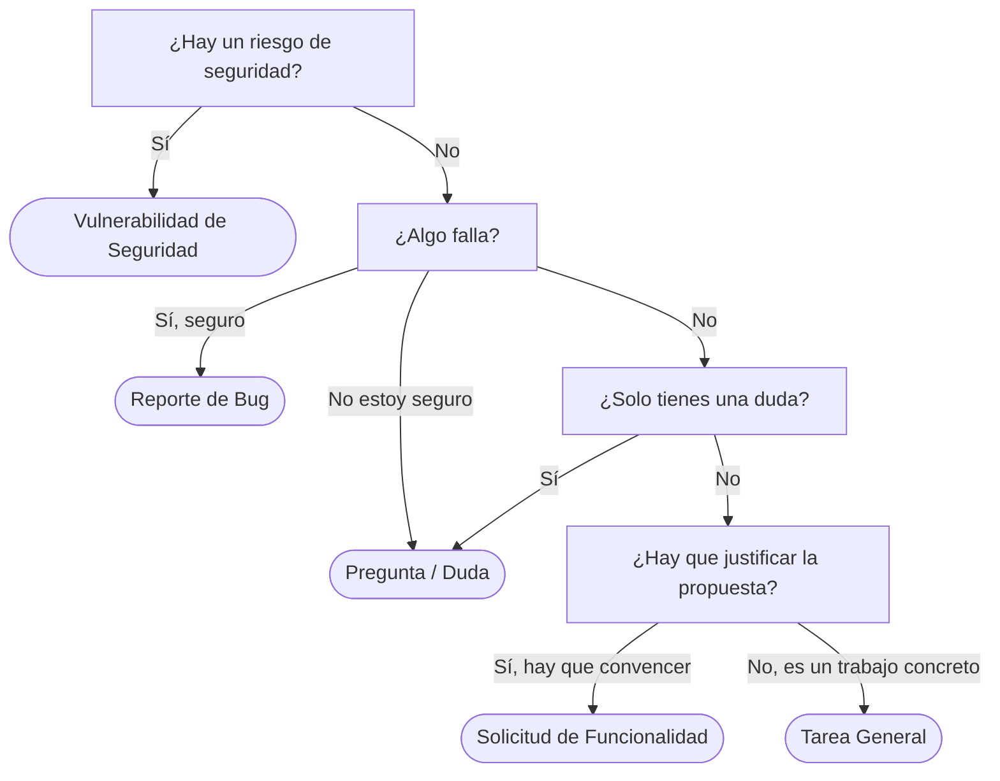

# ¿Qué plantilla de issue elijo?

Este repo es [monium/gitanddocs](https://github.com/monium/gitanddocs). Son los apuntes de la clase de 2º DAM (DPL), escritos en Markdown, y Zensical los convierte en esta web. Los mantiene la clase, pero cualquiera puede abrir una issue.

Has entrado en la pestaña **Issues**, has pulsado **New issue** y te salen cinco plantillas. A veces sale también una sexta opción, **Blank issue**. Esa no la uses: lo explicamos más abajo. Esta página te ayuda a elegir la plantilla correcta rápido. Mira la tabla y, si sigues con dudas, sigue el diagrama. Más abajo tienes el detalle de cada plantilla.

## Elige en 20 segundos

| Si te pasa esto | Usa esta plantilla |
| --- | --- |
| Un enlace está roto o un comando de los apuntes da error | **Reporte de Bug** |
| Se te ocurre una mejora y hay que explicar por qué merece la pena | **Solicitud de Funcionalidad** |
| Hay que escribir los apuntes de un tema o reorganizar algo, y ya está claro que se hace | **Tarea General** |
| No sabes cómo hacer algo, o no sabes si el fallo es tuyo | **Pregunta / Duda** |
| Has visto una contraseña o un token subidos | **Vulnerabilidad de Seguridad** (avisa antes al profesor en privado) |

## Las cinco plantillas de un vistazo

Los nombres son los mismos que ves en el menú de New issue.

-   :lucide-bug:{ .lg .middle } **Reporte de Bug**

    ---

    **Sabes seguro** que algo que debería funcionar **falla**: un error, un enlace roto, un archivo mal configurado.

    Label: `bug`

-   :lucide-lightbulb:{ .lg .middle } **Solicitud de Funcionalidad**

    ---

    **Propones** algo que el proyecto no hace, o una mejora de cómo funciona. Tienes que explicar el problema y convencer.

    Label: `enhancement`

-   :lucide-list-checks:{ .lg .middle } **Tarea General**

    ---

    Un **trabajo concreto** que ya está claro que hay que hacer: documentar un tema, reorganizar, configurar, tests.

    Label: no se pone sola (si son apuntes, se añade `documentation`)

-   :lucide-circle-help:{ .lg .middle } **Pregunta / Duda**

    ---

    Tienes una **duda** técnica o de proceso, o no sabes si algo es un fallo o lo estás usando mal.

    Label: `question`

-   :lucide-shield-alert:{ .lg .middle } **Vulnerabilidad de Seguridad**

    ---

    Has visto un **riesgo de seguridad**, por ejemplo una contraseña o un token subidos. Antes de abrir la issue, avisa al profesor en privado.

    Label: no se pone sola

## Si sigues con dudas, sigue el diagrama

Responde a las preguntas de arriba abajo. La primera respuesta que encaje te da la plantilla.

La seguridad va la primera a propósito. Un token subido por error también es "algo que está mal", pero no se trata como un bug normal porque hay que llevarlo con más cuidado.

## Funcionalidad o Tarea General: el caso que más lía

Son las dos plantillas que más se confunden. La diferencia está en si hay que **convencer** o solo **hacer**.

| | Solicitud de Funcionalidad | Tarea General |
| --- | --- | --- |
| La idea | Propones algo que el proyecto no hace, o una mejora de cómo funciona | Un trabajo concreto que ya está claro que hay que hacer |
| Tienes que... | Explicar el problema y convencer | Organizar el trabajo |
| Por eso pide | Problema que Resuelve y Alternativas Consideradas | Lista de tareas y Estimación de Esfuerzo |
| Ejemplo | "Que cada página de apuntes tenga al final una sección de ejercicios" (inventado) | [#43](https://github.com/monium/gitanddocs/issues/43), [#45](https://github.com/monium/gitanddocs/issues/45) |

Pregúntate esto: **¿ya está claro que hay que hacerlo?** Si es así, es una Tarea General. Si todavía tienes que explicar el problema y convencer, es una Solicitud de Funcionalidad.

!!! tip "El caso más habitual en este repo: escribir apuntes"

    Si vas a escribir los apuntes de un tema nuevo, eso suele ser **Tarea General** con tipo **Documentación**. Añades contenido a la web, no cambias cómo funciona.

    Antes de abrirla, busca si ya hay una issue de ese tema, también entre las cerradas. Por ejemplo, el despliegue de task-api ya se documentó en [#45](https://github.com/monium/gitanddocs/issues/45). Si está abierta, comenta en ella y no abras otra.

## Antes de crear la issue

Comprueba esto:

1. **Busca si ya existe.** Entra en la pestaña **Issues** y usa el buscador. Si alguien ya la ha abierto, comenta en esa y no crees otra.
2. **Pon un título que se entienda solo.** Una frase que diga el problema o la tarea. "No funciona" no vale. "El menú de New issue ignora config.yml: el enlace de ayuda no sale y no se limita Blank issue" sí vale.
3. **Una issue por problema.** Si tienes dos cosas distintas, abre dos issues, cada una con su plantilla.

!!! warning "El repo es público"

    Cualquiera puede leer las issues, también gente de fuera de clase. Nunca pongas en una issue contraseñas, tokens ni cómo aprovechar un fallo de seguridad.

## Cada plantilla en detalle

Pulsa en la pestaña de la plantilla que te interese. Debajo del nombre está la descripción tal como sale en el menú.

=== ":lucide-bug: Reporte de Bug"

    > *Reporta un error para que podamos corregirlo*

    **Label:** `bug`

    **Úsala si:**

    - Sabes seguro que algo que debería funcionar no funciona: un comando, una página, un enlace, una configuración.
    - La web da avisos o errores al generarse.

    **No la uses si:**

    - Es un tema de seguridad: usa **Vulnerabilidad de Seguridad**.
    - No sabes si es un fallo o lo estás usando mal: empieza por **Pregunta / Duda**.
    - Funciona bien pero te gustaría que hiciera otra cosa: eso es **Solicitud de Funcionalidad**.

    **Qué te pide rellenar:**

    | Apartado | Qué poner |
    | --- | --- |
    | Descripción del Bug | Qué falla, en una o dos frases |
    | Pasos para Reproducir | Lo que hay que hacer para ver el error, en orden |
    | Comportamiento Esperado | Lo que debería pasar |
    | Comportamiento Actual | Lo que pasa de verdad |
    | Evidencia | Captura, mensaje de error o salida de la terminal |
    | Entorno | Sistema operativo, navegador, versiones |
    | Severidad | Crítica, Alta, Media o Baja |
    | Proyecto | Añadir la issue al Project de la clase (columna derecha, apartado Projects) |

    !!! tip "Lo que más ayuda"

        Los **pasos para reproducir**. Si otra persona consigue ver el error siguiendo tus pasos, el bug se arregla mucho antes.

    **Ejemplos reales del repo:**

    - [#41 El menú de New issue ignora config.yml: el enlace de ayuda no sale y no se limita Blank issue](https://github.com/monium/gitanddocs/issues/41)
    - [#33 Arreglar los warnings de anchor](https://github.com/monium/gitanddocs/issues/33) (avisos al generar la web por enlaces a apartados que no existen)

=== ":lucide-lightbulb: Solicitud de Funcionalidad"

    > *Propón una nueva funcionalidad o mejora*

    **Label:** `enhancement`

    **Úsala si:**

    - Propones algo que el proyecto todavía no hace.
    - Quieres cambiar cómo funciona algo que ya existe para que sea mejor.
    - Todavía hay que explicar **por qué** y convencer al resto. Por eso la plantilla te pide el problema que resuelve y las alternativas.

    **No la uses si:**

    - Ya está claro que hay que hacerlo y solo falta hacerlo: eso es **Tarea General**.
    - Vas a escribir los apuntes de un tema: eso suele ser **Tarea General**.
    - Algo que ya existe está roto: eso es **Reporte de Bug**.

    **Qué te pide rellenar:**

    | Apartado | Qué poner |
    | --- | --- |
    | Descripción de la Funcionalidad | Qué propones |
    | Problema que Resuelve | Qué falta o qué molesta ahora. Es la parte que tiene que convencer |
    | Solución Propuesta | Cómo lo harías tú |
    | Alternativas Consideradas | Otras opciones que has pensado y por qué no te convencen |
    | Criterios de Aceptación | Cómo sabremos que está terminado |
    | Prioridad | Alta, Media o Baja |
    | Proyecto | Añadir la issue al Project de la clase (columna derecha, apartado Projects) |

    **Ejemplo** (inventado):

    > **Título:** Añadir una sección de ejercicios al final de cada página de apuntes
    >
    > **Problema que Resuelve:** Ahora los apuntes solo tienen teoría y no hay forma de comprobar si has entendido el tema.

    **Ejemplo real del repo:** [#10 Aprender a crear una Issue](https://github.com/monium/gitanddocs/issues/10)

=== ":lucide-list-checks: Tarea General"

    > *Cualquier tarea que no sea bug ni feature (refactor, docs, tests, config...)*

    **Label:** no se pone sola. Cuando son apuntes, se añade a mano `documentation`.

    **Úsala si:**

    - Es un trabajo concreto y ya está claro que hay que hacerlo. No hay que convencer a nadie: solo hay que hacerlo.
    - Puedes dividirlo en una lista de pasos. Por eso la plantilla pide una checklist y una estimación.
    - Vas a escribir los apuntes de un tema nuevo.

    **No la uses si:**

    - Todavía hay que explicar el problema y convencer: eso es **Solicitud de Funcionalidad**.
    - Lo que quieres es arreglar algo que falla: eso es **Reporte de Bug**.

    **Qué te pide rellenar:**

    | Apartado | Qué poner |
    | --- | --- |
    | Descripción | Qué hay que hacer y para qué |
    | Tareas | Una checklist con los pasos |
    | Tipo de Tarea | Documentación, Refactorización, Tests, Configuración/infraestructura, Seguridad, Dependencias o Diseño/UI |
    | Estimación de Esfuerzo | Una talla, de XS (muy poco) a XL (mucho) |
    | Dependencias | De qué issue depende y a cuál bloquea |
    | Proyecto | Añadir la issue al Project de la clase (columna derecha, apartado Projects) |

    **Ejemplos reales del repo** (los dos de tipo Documentación):

    - [#43 Documentar Git intermedio: merge, rebase, conflictos, deshacer cambios, .gitignore y tags](https://github.com/monium/gitanddocs/issues/43)
    - [#45 Documentar el despliegue de task-api con Docker y Kamal](https://github.com/monium/gitanddocs/issues/45)

=== ":lucide-circle-help: Pregunta / Duda"

    > *Tienes una duda técnica o de proceso que no es un bug ni una mejora*

    **Label:** `question`

    **Úsala si:**

    - No sabes cómo hacer algo del proyecto.
    - No tienes claro cómo funciona el proceso del equipo.
    - Crees que algo falla, pero no sabes si es un fallo o lo estás haciendo mal.

    **No la uses si:**

    - Sabes seguro que algo está roto: **Reporte de Bug**.
    - En realidad estás proponiendo un cambio: **Solicitud de Funcionalidad**.

    **Qué te pide rellenar:**

    | Apartado | Qué poner |
    | --- | --- |
    | Pregunta | Tu duda, lo más concreta posible |
    | Contexto | Qué estabas haciendo y qué has probado ya |
    | Referencias | Enlaces a páginas, issues o documentación que hayas mirado |
    | Proyecto | Añadir la issue al Project de la clase (columna derecha, apartado Projects) |

    **Ejemplo** (inventado, todavía no hay ninguna pregunta en el repo):

    > **Título:** ¿Cómo levanto Zensical en local?
    >
    > **Contexto:** He clonado el repo y quiero ver mis cambios antes de hacer push, pero no sé qué comando usar.

=== ":lucide-shield-alert: Vulnerabilidad de Seguridad"

    > *Reporta un problema de seguridad de forma responsable*

    **Label:** no se pone sola.

    !!! danger "Primero avisa en privado, después abre la issue"

        La propia plantilla avisa: si es grave, no publiques detalles sensibles y contacta antes por un canal privado. Una contraseña o un token subidos a un repo público **siempre** son graves. Como el repo es público, una issue que diga dónde está el secreto también avisa a cualquiera que la lea.

        Sigue este orden:

        1. **Avisa al profesor en privado** (en persona o por un mensaje directo, nunca en una issue ni en un comentario).
        2. **Espera** a que el secreto se cambie o se quite del repo.
        3. **Abre la issue** con esta plantilla para que quede registrado, sin datos sensibles.

        Si eres de fuera de clase y no tienes forma de contactar en privado, abre la issue sin ningún detalle: di solo que hay un problema de seguridad y que necesitas un canal privado para contarlo.

    **Úsala si:**

    - Has visto datos sensibles donde no deberían estar, como una contraseña o un token subido al repo.
    - Algo permite hacer cosas que no se deberían poder hacer.

    **No la uses si:**

    - Es un fallo normal sin riesgo para nadie: **Reporte de Bug**.
    - Es un trabajo de seguridad ya planificado (por ejemplo, revisar una configuración): eso puede ir como **Tarea General** con tipo Seguridad.

    **Qué te pide rellenar:**

    | Apartado | Qué poner |
    | --- | --- |
    | Descripción de la Vulnerabilidad | Qué tipo de problema es, sin datos sensibles |
    | Componente Afectado | Qué archivo, servicio o parte del proyecto |
    | Impacto Potencial | Qué podría pasar si alguien lo aprovecha |
    | Pasos para Reproducir | **Solo si es seguro** contarlos en público |
    | Severidad | El nivel que ofrece la plantilla. Si hay contraseñas o tokens expuestos, el más alto |
    | Mitigación Sugerida | Cómo lo arreglarías o cómo reducir el riesgo mientras tanto |
    | Proyecto | Añadir la issue al Project de la clase (columna derecha, apartado Projects) |

    **Ejemplo** (inventado, no hay ninguno real en el repo):

    > **Título:** Había un token subido en un archivo del repositorio
    >
    > Bien: "En un archivo de configuración había un token de acceso en texto plano. Ya se avisó al profesor y se ha revocado."
    >
    > Mal: copiar el token en la issue, o decir dónde está antes de que se haya revocado.

## ¿Y "Blank issue"?

Blank issue es una issue en blanco, sin plantilla. **No la uses.** Elige siempre una plantilla, aunque algún apartado te quede corto. Así la issue tiene los apartados que todos esperan y, en la mayoría de plantillas, ya sale con su label.

Que la veas o no depende de tus permisos. El repo la tiene desactivada, pero según la [documentación de GitHub](https://docs.github.com/en/communities/using-templates-to-encourage-useful-issues-and-pull-requests/configuring-issue-templates-for-your-repository) quien tiene permiso de escritura (la gente de clase) la sigue viendo con la marca *Maintainers only*. Quien viene de fuera solo ve las plantillas.

## Casos dudosos

??? question "Algo me falla pero no sé si es culpa mía"

    Si no estás seguro de si es un fallo o lo estás haciendo mal, abre una **Pregunta / Duda** y cuenta lo que has probado. Si al final se confirma que es un fallo, entonces se abre el **Reporte de Bug**.

??? question "Un enlace roto o un aviso al generar la web, ¿bug o tarea?"

    **Reporte de Bug.** Algo que debería estar bien está mal. Mira [#33](https://github.com/monium/gitanddocs/issues/33): avisos por enlaces a apartados que no existen.

??? question "Un archivo de configuración que no funciona, ¿bug o tarea?"

    Si debería funcionar y no lo hace, **Reporte de Bug**, como [#41](https://github.com/monium/gitanddocs/issues/41). Si hay que configurar algo nuevo y ya está claro que se hace, es **Tarea General** con tipo Configuración/infraestructura.

??? question "Quiero escribir la guía de un tema y la idea es mía"

    **Tarea General** con tipo Documentación. Añadir apuntes es contenido, no cambia cómo funciona la web. Antes busca si ya hay una issue de ese tema: si existe, comenta en esa.

??? question "Una guía que además cambia cómo funciona algo del repo"

    **Solicitud de Funcionalidad.** Por ejemplo, esta misma página: no son solo apuntes, también cambia el enlace de ayuda del menú de New issue para que lleve aquí. Eso es una mejora de cómo funciona el repo y hubo que explicar el problema y convencer.

??? question "He encontrado una contraseña o un token subidos, ¿bug o seguridad?"

    **Vulnerabilidad de Seguridad**, siempre. Primero avisa al profesor en privado, espera a que se cambie o se quite, y después abre la issue sin copiar el secreto.

??? question "Quiero reorganizar las carpetas de docs"

    Si ya está claro que se hace, **Tarea General** con tipo Refactorización. Si es una idea tuya y tienes que explicar el problema y convencer, **Solicitud de Funcionalidad**.

??? note "Qué es una label y cómo se añade"

    Una label es una etiqueta de color que clasifica la issue (`bug`, `question`, `documentation`...). Casi todas las plantillas la ponen solas. Tarea General y Vulnerabilidad de Seguridad intentan poner `task` y `security`, pero esas labels no existen en el repo, así que salen sin ninguna.

    Para añadirla a mano, usa el apartado **Labels** de la columna derecha de la issue. Si no te deja (hace falta tener permisos en el repo), dilo en la issue y la pondrá alguien de la clase.