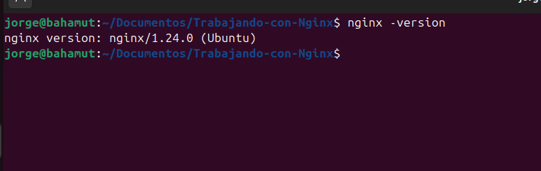
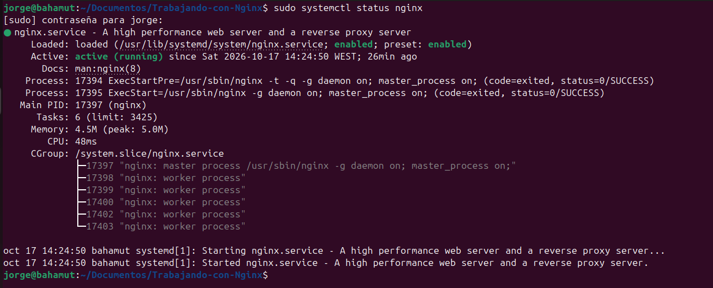
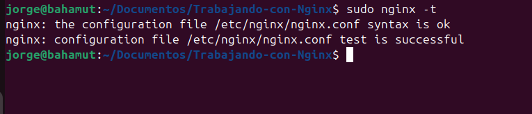
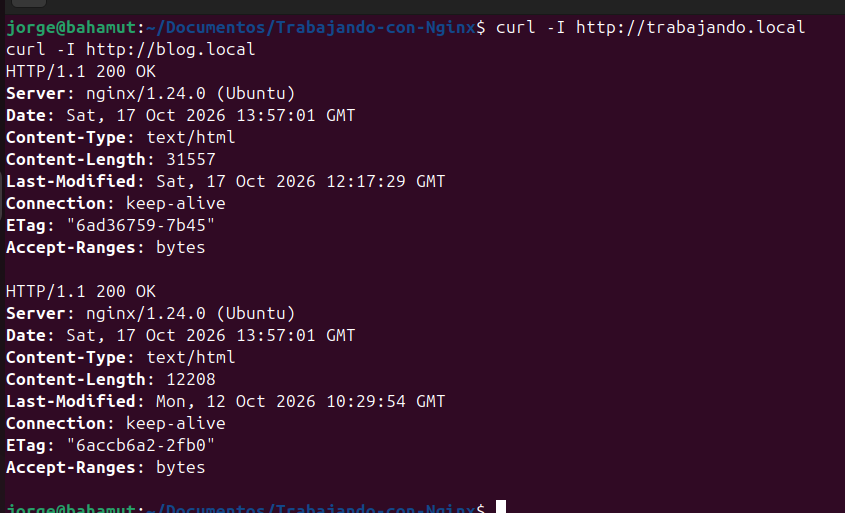

# Instalación NGINX

## ¿Qué es NGINX?

Nginx es un servidor web. Es un programa que entrega páginas web, que se queda encendido en un ordenador esperando a que alguien le pida una página web. Cuando se la piden, la busca y la entrega.


## Guía paso a paso

### Requisitos previos:

1. Para la práctica necesitamos tener al menos un sitio web estático para documentación, que aprovechamos: `UV Zensical`.

2. Un blog igualmente estático de : `jekyll`.

Con ambas web estáticas por separado podemos añadirlas a nuestro Nginx para poder ofrecer el servicio simultáneo.

### Instalación Nginx

```
sudo apt update
sudo apt install nginx
sudo systemctl status nginx
```



Qué hace cada comando:

- `sudo apt update`: actualiza la lista de programas disponibles, como mirar el catálogo antes de comprar.
- `sudo apt install nginx`: descarga e instala NGINX.
- `sudo systemctl status nginx`: pregunta al sistema si NGINX está encendido.

Cómo saber que ha ido bien: en la salida debe aparecer active (running) (pulsa q para salir de esa pantalla).

Al instalarse, NGINX arranca solo y empieza a escuchar en el puerto 80. Si abres http://localhost en un navegador, verás su página de bienvenida.

### Publicar los archivos en las dos webs
NGINX no corre con tu usuario, sino con uno propio del sistema **(www-data)**, que no puede entrar en tu carpeta personal. Por eso las webs se copian a `/var/www/`, que es donde, por convención, se dejan las webs de un servidor. Cada sitio tiene su carpeta.

```
sudo mkdir -p /var/www/trabajando-nginx /var/www/blog
sudo cp -r ~/Documentos/Trabajando-con-Nginx/site/* /var/www/trabajando-nginx/
sudo cp -r ~/Documentos/miblog-business/_site/* /var/www/blog/
```
- `mkdir -p:` crea las carpetas, y las que falten por el camino.
- `cp -r:` copia archivos y carpetas con todo su contenido.

### Escribir archivo de configuración NGINX
Con este archivo le explicas a NGINX qué hacer.


#### Sitio 1: trabajando

`sudo nano /etc/nginx/sites-available/trabajando-nginx`
Dentro del archivo introducimos:
```
server {
    listen 80;
    server_name trabajando.local;

    root /var/www/trabajando-nginx;
    index index.html;

    location / {
        try_files $uri $uri/ =404;
    }
}
```


#### Sitio 2: blog
`sudo nano /etc/nginx/sites-available/blog`
```
server {
    listen 80;
    server_name blog.local;

    root /var/www/blog;
    index index.html;

    location / {
        try_files $uri $uri/ =404;
    }
}
```

| Línea | Qué significa |
| :--- | :--- |
| **`server { ... }`** | "Voy a describir un sitio web". Cada `server` es un sitio diferente. |
| **`listen 80;`** | "Atiende por la ventanilla número 80" (puerto estándar para tráfico web HTTP sin seguridad). |
| **`server_name trabajando.local;`** | "Este sitio responde cuando alguien pida el nombre `trabajando.local`". |
| **`root /var/www/trabajando-nginx;`** | "Los archivos de este sitio están guardados en esta carpeta". |
| **`index index.html;`** | "Si piden una carpeta sin decir un archivo concreto, entrega `index.html` por defecto". |
| **`location / { ... }`** | "Esto se aplica a todas las direcciones que empiecen por `/`", es decir, afecta a todo el sitio web. |
| **`try_files $uri $uri/ =404;`** | "Intenta encontrar el archivo pedido. Si no existe, búscalo como carpeta. Si tampoco existe, devuelve un error 404". |

### Activar el sitio y recargar NGINX

```
sudo ln -s /etc/nginx/sites-available/trabajando-nginx /etc/nginx/sites-enabled/
sudo ln -s /etc/nginx/sites-available/blog /etc/nginx/sites-enabled/
sudo nginx -t
sudo systemctl reload nginx
```
sites-available y sites-enabled: en Ubuntu y Debian, NGINX usa dos carpetas.

- `sites-available/` es el cajón con todos los sitios que has escrito, estén activos o no.
- `sites-enabled/` contiene los sitios que están encendidos.

El comando `ln -s` crea un acceso directo desde sites-enabled hacia el archivo de sites-available. Así puedes encender y apagar un sitio sin borrar su configuración.


`nginx -t` significa "test". Revisa la sintaxis sin tocar nada. Es tu red de seguridad. Debe decir:

```
nginx: the configuration file /etc/nginx/nginx.conf syntax is ok
nginx: configuration file /etc/nginx/nginx.conf test is successful
```


`systemctl reload nginx` aplica la nueva configuración sin cortar a quien esté conectado en ese momento.

### Enseñar los nombres a tu máquina

`trabajando.local` y `blog.local` son nombres inventados que no existen en internet. El archivo `/etc/hosts` funciona como una agenda propia de tu ordenador: ahí le decimos a qué dirección ir cuando alguien pide esos nombres.

```
echo "127.0.0.1 trabajando.local blog.local" | sudo tee -a /etc/hosts
```

La línea significa: "cuando alguien pida `trabajando.local` o `blog.local`, vete a `127.0.0.1`", que es siempre tu propio ordenador. Allí está NGINX esperando.

### Comprobar que funciona

```
curl -I http://trabajando.local
curl -I http://blog.local
```



Los dos deben devolver `HTTP/1.1 200 OK`. Después, abre en el navegador:

- `http://trabajando.local`
- `http://blog.local`

Si sale un **404**, mira qué ruta ha buscado NGINX con `sudo tail -n 5 /var/log/nginx/error.log` y compárala letra por letra con la carpeta que hay en `ls /var/www`.

### Gestionar NGINX

NGINX es un servicio del sistema: arranca solo al encender la máquina y se queda esperando peticiones. Se controla con `systemctl`:

| Comando | Qué hace |
|---|---|
| `sudo systemctl status nginx` | Dice si está encendido o apagado |
| `sudo systemctl start nginx` | Lo enciende ahora |
| `sudo systemctl stop nginx` | Lo apaga ahora |
| `sudo systemctl reload nginx` | Aplica cambios de configuración sin cortar nada |
| `sudo systemctl restart nginx` | Lo apaga y lo enciende |
| `sudo systemctl enable nginx` | Hace que arranque solo al encender la máquina |
| `sudo systemctl disable nginx` | Evita que arranque solo |
| `sudo nginx -t` | Comprueba que la configuración no tiene errores |


**Cambiar la configuración.** Siempre en este orden: editar, probar y aplicar.
```
sudo nano /etc/nginx/sites-available/trabajando-nginx
sudo nginx -t
sudo systemctl reload nginx
```


### Actualizar el contenido de una web

Cuando cambies tus apuntes o tu blog, hay que generar la web y copiarla a la carpeta que NGINX entrega. No hace falta recargar NGINX, porque solo cambian archivos y no su configuración.

**Para la documentación de Zensical:**
```
uv run zensical build
sudo rsync -a --delete site/ /var/www/trabajando-nginx/
```


**Para el blog de Jekyll:**
```

bundle exec jekyll build
sudo rsync -a --delete _site/ /var/www/blog/
```

**rsync** sincroniza las dos carpetas, y **--delete** elimina del destino lo que ya no existe en el origen. Si no lo tienes instalado: `sudo apt install rsync`.

Después abre la web y refresca con Ctrl + Shift + R, para que el navegador no te enseñe la versión que tenía guardada.


